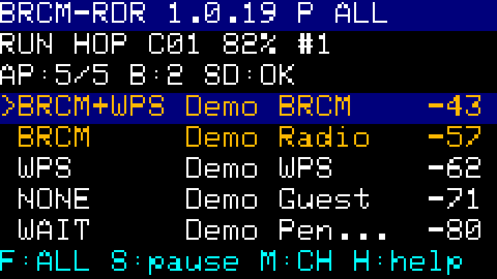
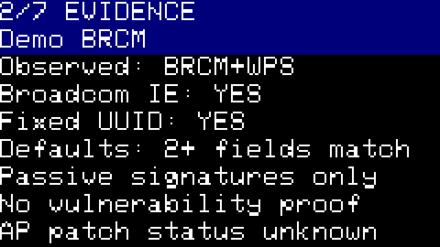
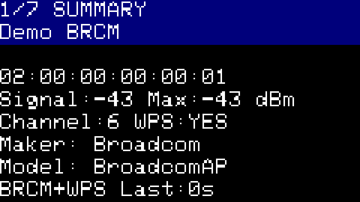
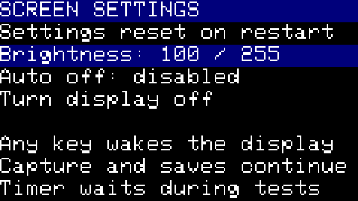

# Broadcom Radar: Wi-Fi/WPS detector for M5Stack Cardputer

See Broadcom and WPS details from nearby **2.4 GHz Wi-Fi networks**, right on your Cardputer. Open a network to inspect its evidence, then save what you find to microSD for a closer look on your computer.

Built for **M5Stack Cardputer ADV** and the **original Cardputer** (ESP32-S3), with installation through your existing **M5Launcher**.

> **Authorized use only:** Test networks you own or have explicit permission to assess. Radar helps with security inventory and planning vendor firmware updates. Advertised fingerprints are evidence, not a verdict on vulnerability, patch status or safety.

**Published release 1.0.12** · [MIT license](LICENSE) · [All releases](https://github.com/lexejs/broadcom-radar/releases)

Development source: **1.0.18**, not yet published as a release. The downloads below remain the published 1.0.12 images.

[Download](#download-and-choose-a-firmware) · [Get started](#quick-start) · [Read the results](#meaning-of-results) · [Controls](#controls) · [FAQ](#frequently-asked-questions) · [Research](RESEARCH.md)

## Download and choose a firmware

**Before downloading:** your Cardputer must already run [M5Launcher](https://github.com/bmorcelli/Launcher/wiki/Explaining-the-project). These published images use **Poland (`PL`), channels 1-13**. For another operating country, follow the [country configuration](#radio-and-memory-decisions) before building. An **app slot** is reserved internal flash space for one application; check its actual size in Launcher.

**New here? Choose the passive scanner for your device:**

| Your device | Recommended download | Manifest (size and SHA-256) |
| --- | --- | --- |
| **Cardputer ADV** (Stamp-S3A) | [ADV firmware 1.0.12 (.bin)](https://github.com/lexejs/broadcom-radar/releases/download/v1.0.12/BRCM-RDR-1.0.12.bin) | [Size and SHA-256](https://github.com/lexejs/broadcom-radar/releases/download/v1.0.12/BRCM-RDR-1.0.12.bin.json) |
| **Original Cardputer** (Stamp-S3) | [Original firmware 1.0.12 (.bin)](https://github.com/lexejs/broadcom-radar/releases/download/v1.0.12/BRCM-RDR-S3-1.0.12.bin) | [Size and SHA-256](https://github.com/lexejs/broadcom-radar/releases/download/v1.0.12/BRCM-RDR-S3-1.0.12.bin.json) |

These builds listen to existing Wi-Fi advertisements and do not start active WPS tests. Both builds pass automated checks; on-device operation of 1.0.12 remains unverified on either board. Optional `-T`, `-C` and `-F` research images are explained [below](#experimental-on-device-wps-tests).

## Screen previews

The network list puts Broadcom observations first. Open a row to see which advertised fields produced the result.

<p>
  
  
</p>

*Rendered from the production UI with synthetic example networks. These are not device photos or evidence of hardware validation.*

<details>
<summary>More screens: network details and display settings</summary>

<p>
  
  
</p>

</details>

## Quick start

1. **Choose your device.** Download its `.bin` and matching manifest from the table above. Compare the file size and SHA-256 with the manifest.
2. **Install through M5Launcher.** Copy the `.bin` to microSD and install it into a compatible app slot. Keep Launcher, your other apps and their data. Read the [installation steps](#installation-through-the-existing-m5launcher) before selecting a slot.
3. **Take your first look.** Start Radar and wait through several channel sweeps. `RUN` and a changing channel show that scanning is active. Find your own Wi-Fi name (**SSID**). If names repeat, compare the **BSSID**, the identifier of that individual access point, with the 2.4 GHz radio shown in your router administration interface. Use **`;` up / `.` down** and press **Enter** for SUMMARY; press **Enter** again for EVIDENCE. **Backspace** returns to the list and **H** opens help.
4. **Save your observations.** Press **E**, wait for `Saved scan-NNN`, then open `/broadcom-radar/scan-NNN.csv` on microSD and find the BSSID from SUMMARY. This saves all stored networks, including rows hidden by a filter.

microSD is needed to save files, but scanning still works without a card. **WPS** means Wi-Fi Protected Setup, a router setup feature; Radar records whether its advertisement was observed. `Maker` and `Model` are WPS-advertised identity fields and can contain generic defaults such as `BroadcomAP`. Use your router administration interface or manufacturer label for its retail model, hardware revision and installed firmware version. The rightmost number in each list row is signal strength in dBm.

## Installation through the existing M5Launcher

- **Back up first:** retain the previous app's binary and data, including important Launcher files such as `/config.conf` and `/bkp`. Keep a copy off the card and check your existing recovery method. Launcher may reset shared Wi-Fi settings during installation.
- **Check the slot:** these images need at least **1 MiB (1,048,576 bytes)** after alignment. Use the requirement in your exact manifest and the actual Launcher partition list. Available flash varies by device.
- **Install the application only:** in Launcher, open **SD**, select the matching `.bin` and choose the intended compatible app slot. An occupied slot's previous app will be replaced. A separate slot is possible if your Launcher supports it and has confirmed free space.
- **Preserve the existing layout:** decline removal, movement, resizing or formatting of existing partitions and compaction. If installation would change another app or its data, stop. Radar needs no filesystem partition.

Keep the resident Launcher. Do not flash a bootloader, partition table, merged image or full dump, and do not run erase-flash. Direct PlatformIO upload is disabled in this project.

<details>
<summary>File verification and detailed installation steps</summary>

On macOS, run `shasum -a 256 BRCM-RDR-1.0.12.bin`; on Linux, use `sha256sum BRCM-RDR-1.0.12.bin`. Compare the output with the manifest shipped with that exact image.


1. Keep the existing Launcher installed. Before replacing an app, retain its original `.bin`, back up its data using the facilities available in your Launcher version, and preserve `/config.conf` and `/bkp` on the SD card. Keep an off-card copy of important backups. Check the existing boot-to-Launcher/recovery setting before installation.
2. Open **PMan** or the installed version's partition list. Identify an OTA app slot large enough for the `required_aligned_app_partition_bytes` in the selected `.bin.json`. A Launcher version supporting dynamic partitions can instead create a separate app slot in confirmed free flash space. Preserve the resident Launcher and all other apps and data. The conservative 1.5 MiB build guard is not a measurement of free space on your device.
3. Copy the matching `.bin` to the microSD card, for example `/firmware/BRCM-RDR-1.0.12.bin`. FAT32 on an MBR SDHC card is a conservative choice; the installed Launcher may also support other formats. Insert the card.
4. Enter Launcher, open **SD**, select the `.bin`, then the install action. Choose the intended compatible app slot, with the understanding that selecting an occupied slot replaces its app. Menu wording varies by Launcher version. Review any proposed new slot against the actual free space; decline removal, resizing or movement of existing partitions, compaction, formatting and filesystem installation. This application needs no data partition. Stop if installation requires changing other apps or their data.
5. Start the installed app. The initial screen should show `BRCM-RDR 1.0.12`, its build variant, `RUN`, and a changing channel. Reception is passive; wait through several channel sweeps.

**Do not flash `bootloader.bin`, `partitions.bin`, a merged image or a full dump. Do not run erase-flash.** `partitions-build-only.csv` exists solely for linking and size checking; it is never part of the installation package. Direct `pio run -t upload` is deliberately disabled to protect Launcher.

If you already have a raw partition-table export or a CSV describing the actual installed table, this read-only check verifies that the image fits an existing OTA slot:

```sh
python3 scripts/check_launcher_partition.py dist/BRCM-RDR-1.0.12.bin /path/to/actual-partitions.bin --label app1
```

Use the real OTA partition label. This script does not read or write flash, resize partitions or install anything. Without a real table, only image-format and build-limit checks are possible. Current upstream Launcher uses dynamic partitions; an 8 MB flash chip alone does not establish the available app slot size.

</details>

<details>
<summary>Return to Launcher, rollback and updates</summary>

- Pause with **S** and export with **E** if needed. Power-cycle or reset normally, then press **Enter** at the Launcher start screen to enter its menu. This is the documented upstream boot flow. Boot settings and custom bootloaders can change it; use the recovery method already configured in the installed Launcher. Holding **G0** during power-on enters the ESP download mode and is not the normal Launcher return procedure.
- To roll back, enter Launcher and install the saved previous application binary into the same existing OTA slot. Restore its associated data backup if the app requires it. Restoring an application binary alone does not restore that app's data.
- To update Radar, copy the newer matching application `.bin` to SD and repeat installation into the same sufficiently large slot. Radar has no persistent settings or filesystem partition; channel mode, results and PCAP selection reset on restart. Exports on SD remain available.
- Radar disables Wi-Fi NVS credential loading and uses RAM Wi-Fi configuration. It never erases NVS or writes the partition table. Launcher itself controls installation metadata and backup behavior. Current Launcher source can reset the Wi-Fi driver's `net80211` namespace during installation, so preservation of every other application's configuration cannot be guaranteed by Radar. Preserve backups before installation; do not accept installer repartitioning or data-format changes.

Installation of the ADV `-F` image through Launcher 2.8.0 was confirmed on 20 October 2026. The SD source matched the local image byte for byte, the installer returned success, and a fresh partition listing identified the installed app while preserving every existing partition. Launcher was still running after installation. Application startup, the SD-menu installation route, rollback and return-to-Launcher procedures remain separate hardware checks.

</details>

## Meaning of results

The labels describe **what Radar has observed**:

| On screen | What it means |
| --- | --- |
| **BRCM+WPS** | A Broadcom signature and WPS advertisement were observed for the same network. Shown first. |
| **BRCM** | A Broadcom signature was observed; WPS has not been observed. |
| **WPS** | WPS was observed without a Broadcom signature. |
| **NONE** | A complete advertisement was read without a characteristic signature. |
| **WAIT** | The available advertisement data is incomplete or malformed. |

**A fingerprint does not establish vulnerability, patch status or safety.** `NONE` and `WAIT` do not mean safe. Press **Enter** to inspect the evidence behind a result.

## Controls

| You want to... | Press |
| --- | --- |
| Choose a network and inspect it | **Arrows**, then **Enter** |
| Open help | **H** |
| Return to the previous screen | **Esc** or **Backspace** |
| Pause or resume scanning | **S** |
| Save all stored networks | **E** |
| Buffer recent advertisements for the next scan export | **P**, then **E** |
| Clear live data while keeping SD files | **R** twice within 3 seconds |
| Show all networks, WPS candidates or Broadcom+WPS candidates | **F**: `ALL` → `WPS` → `B+W` |
| Switch discovery / signal order within groups (development 1.0.15+) | **O** |
| Choose the operating country (development 1.0.14+) | **C**, arrows, then **Enter** |
| Adjust the screen or turn it off | **B** for settings; **L** to blank it |

The first key after screen-off only wakes the display. Scanning, channel hopping and automatic saves continue while the display is blank.

<details>
<summary>All keyboard controls and display behavior</summary>

| Key | Action |
| --- | --- |
| Up / Down | Select AP; select a text field in details; choose channel |
| Left / Right | Select AP; switch detail pages; choose channel |
| Enter | Open details; next detail page; apply selected channel |
| Esc / Backspace | Return to the previous screen; cancel a running test |
| S | Pause or resume capture |
| R twice within 3 seconds | Clear live APs, counters and buffered PCAP; preserve SD files and running/paused state |
| E | Export JSON/CSV and optional PCAP; automatically pause capture and restore its prior state |
| M | Choose `HOP` or hold one channel |
| O | Toggle discovery order / strongest current RSSI within each detection group (development 1.0.15+) |
| C | Choose a supported country; Enter applies, Backspace cancels (development 1.0.14+) |
| P | Toggle bounded PCAP capture, clearing the previous PCAP buffer |
| H | Open or close five-page help, preserving the previous screen and page |
| B | Open screen settings: brightness, optional idle timeout, display off |
| L | Turn the display off; the next press only wakes it |
| V | Read the full selected SSID or WPS text field; arrows change text pages |
| D | From Help open scan diagnostics; from a test toggle its diagnostics |
| F | Cycle display filter: `ALL` -> `WPS` candidates -> `B+W` (Broadcom WPS candidates) |

On the compact keyboard, the arrow positions are **`;` up, `.` down, `,` left, `/` right**. These work directly or through the Fn arrow mapping. **Fn + backtick** is Escape; plain backtick and Backspace also return. Letter commands accept either case. Changes to scan state, filters, results and PCAP buffering are disabled during export; navigation remains available.

The main screen shows firmware version, build variant (`P` passive, `T` stock test, `C` transport, `F` fingerprint), active filter, running state, channel mode, battery estimate, selection position, visible/stored AP count, Broadcom count and SD availability. A full 128-entry store displays `FULL`; scan diagnostics distinguish rejected new-AP advertisements from RX queue drops. Text remains 50% larger (9x12 cells), with five visible APs and explicit BRCM+WPS/BRCM/WPS/NONE/WAIT badges. Groups initially retain discovery order. Development 1.0.15 adds **O** to sort strongest current RSSI first within each group, with discovery order as the tie-breaker. The `RSSI` header marks this mode. The selected AP is preserved as signal values and groups change; scan-driven redraws remain limited to twice per second. Sorting does not change classification, filters or exports. List rows show numeric RSSI in dBm. Long names and values have a visible `...` marker rather than silent clipping.

Only the main screen has a bottom keyboard-hint row. The seven named detail pages are SUMMARY, EVIDENCE, IDENTITY, UUID, ACTIVITY and two VENDOR IEs pages. The overview wraps SSIDs onto two rows; **V** opens a snapshot of the full selected bounded text, including escaped binary values. Up/Down select fields on SUMMARY and IDENTITY. Manual text paging keeps complete `\xNN` tokens together. Display shortening is distinct from source truncation, which the text viewer labels `source limited`. The remaining bottom rows contain data or status, with no keyboard footer.

**H** opens five-page help from any screen and returns to the same screen, detail page and selected field. During a test, help does not stop the state machine; Escape closes help first, and another Escape cancels the test. **D** in help opens scan diagnostics, or test diagnostics when help was opened from a test. A chosen channel is displayed separately from the applied mode; an apply failure keeps the menu open. Paused empty lists explicitly say capture is paused. **R** requires a second press within three seconds; another action cancels the pending reset. Files on SD are preserved.

Since 1.0.10, **F** cycles `ALL` -> `WPS` -> `B+W` -> `ALL`, initially showing all networks. Candidate filters use the same target eligibility check as the manual test: complete data, a known non-hidden SSID, channel 1-13, a valid unicast BSSID and observed WPS. `B+W` additionally requires a Broadcom signature. The main header and footer show the active filter; `AP:2/7` means two visible out of seven stored APs. Incoming observations update membership automatically. An eligible selection is preserved; when it is excluded, selection moves to the first visible AP. An empty result says `No matching networks`, and Enter/T cannot open a hidden row. Filters affect only the displayed list, preserve all collected records and exports, and do not increase the 128-BSSID capacity. Filter changes are disabled during export and test confirmation/execution. Hidden records are not assessed as safe.

Since 1.0.12, **B** opens screen settings from any screen. Brightness steps are 30/50/70/100/150/200/255, initially 100. Auto off is disabled initially; optional timeouts are 30/60/120/300 seconds without keyboard activity. The timer waits during test confirmation, a running test, manual export and screen settings. **L** immediately blanks the display on any screen, including during a test or export. Blanking sets backlight brightness to zero and stops drawing; the LCD controller, CPU, receiver, channel hopping and automatic archives continue. The first key only restores the selected brightness and redraws the current screen; commands are suppressed until all wake keys are released. This prevents wake Enter from starting a test or wake R from clearing data. Held keys prevent automatic blanking. Notifications do not reset inactivity. Screen settings reset on restart. Display blanking does not change the existing radio configuration or establish a measured battery-life improvement.

Only changed rows are transferred to the display, at most twice per second for scan updates and immediately for key presses. Each row is composed in a reusable 240x15 RGB565 canvas (7,200 bytes), then sent without clearing the physical display. DMA completes before the buffer is reused. The existing font is scaled, so no additional font assets are linked. Builds use size optimization, LTO and disabled C++ exceptions. The M5GFX build hook keeps its include-dependent base class consistent across translation units for LTO.

</details>

## Export

Find your saved files in **`/broadcom-radar/`** on microSD:

| What you save | How | Files |
| --- | --- | --- |
| A Broadcom detection | Automatically, when eligible evidence is received | `brcm-NNN.json`, `.csv` and a PCAP of the triggering advertisement (development 1.0.16 can add a cached counterpart) |
| All stored networks, including filtered-out rows | Press **E** | `scan-NNN.json` and `.csv` |
| Recent raw advertisements with that scan | Press **P** to enable buffering, then **E** | Also `scan-NNN.pcap`, containing up to the latest **16** advertisements |

JSON contains detailed evidence; CSV is convenient for a spreadsheet. PCAP holds raw frames for packet tools such as Wireshark. It is a bounded snapshot, not a continuous recording. The manual PCAP ring contains the latest 16 advertisements across all received networks; the selected BSSID may be absent. Automatic Broadcom PCAP saving works independently of P.

Existing exports are preserved. An SD error keeps scanning usable; check the on-screen save status before removing the card.

<details>
<summary>File formats, PCAP details and SD error handling</summary>

Broadcom detections are **saved automatically**, without pressing E or enabling P: `/broadcom-radar/brcm-001.json`, `.csv` and `.pcap` contain one detected BSSID and the raw advertisement that triggered that save. Capture briefly pauses during SD writes and then resumes. A later advertisement creates a new numbered archive only if it adds a Broadcom evidence bit or fills a previously empty WPS identity/UUID field. Repeated advertisements do not write to SD. Deduplication retains the latest 128 distinct saved BSSIDs in RAM, survives R and resets on reboot; older evicted entries can be saved again. An immediately recognizable Broadcom advertisement is archived even when the 128-AP display table is full.

Published 1.0.12 automatic PCAP contains **one triggering advertisement**, independent of the manual 16-frame ring. Development 1.0.16 also includes a previously received counterpart (Beacon versus Probe Response) when available for the same BSSID and capture channel within 30 seconds. A fixed global cache holds two BSSIDs, using four frame buffers (about 9.3 KiB), rather than allocating per-AP raw buffers. A cleared live session invalidates the cache. The older counterpart precedes the triggering frame; JSON records `pcap_frames`, `triggering_frame_index` and `pcap_scope: triggering_advertisement_with_companion` when paired. Missing, stale, foreign or evicted counterparts leave a single-frame archive; later arrival alone does not force another write. The JSON/CSV identity is cumulative for APs in the table, so these one or two frames need not contain every previously observed field or evidence bit. Single-frame JSON records `capture_reason: broadcom_detection` and `pcap_scope: triggering_advertisement`. All three files are written as `.part` first; JSON is published last as the completion marker. Errors leave partial files, keep capture usable and permit another attempt on a received Broadcom advertisement after five seconds. There is no pending-frame queue for detections seen while SD is unavailable.

**E** creates `/broadcom-radar/scan-001.json` and `.csv`, then advances to an unused number. Existing final files and interrupted `.part` files are never overwritten. Writes use a 512-byte buffer and one AP or PCAP record per loop iteration. Each completed file is renamed from `.part`; SD errors keep partial files and leave capture usable. A JSON file may finish before a later CSV/PCAP write fails, so a complete set is indicated by all requested final filenames plus the `Saved` message.

JSON includes schema/firmware/hardware, `passive-only`, monotonic timestamps, country, channel mode, channels listened to, receive/drop/malformed counters, bounds, limitations and all AP records. AP records contain BSSID, raw SSID hex, display string, capability flags, WPS fields/UUIDs, individual evidence with source descriptions, status, latest/maximum RSSI, observed channels and advertisement counts. In scan/detection JSON, `mode: passive-only` describes the observations in that artifact, not the identity of the running firmware or all radio activity during the session. For reproducible research, retain the installed image name and its matching manifest alongside any separate experimental test reports.

JSON strings preserve byte values with `\u00XX` escapes; they are not a UTF-8 interpretation of binary SSIDs. `ssid_hex` is authoritative for original bytes. CSV escapes binary bytes as `\xNN`, quotes fields and protects formula-leading values with an apostrophe. SSID hex remains unchanged. Vendor IEs are summarized by prefix/payload length; enable PCAP if the full received IE bytes are needed.

Manual PCAP buffering is **off by default**; automatic BRCM archives always include their triggering frame. Press **P** to retain only the latest **16** advertisements in a fixed ring. E then also writes `scan-001.pcap`. It is a bounded recent snapshot, not a continuous trace. Both passive PCAP types use classic little-endian PCAP with **DLT_IEEE802_11 (105)**, raw 802.11 frames, no RadioTap and no FCS. Timestamps are monotonic uptime in seconds/microseconds, which viewers display near the Unix epoch. There is no wall clock or NTP. RSSI/channel metadata remains in JSON rather than invented RadioTap headers. Data frames, client payloads and EAPOL are never archived by passive scan exports; experimental test reports have their own bounded session trace.

The exported PCAP was independently opened with libpcap/tcpdump and the raw record structure was validated. Wireshark GUI opening has not been performed. This is the standard raw-802.11 PCAP format supported by Wireshark.

An absent SD card does not stop scanning. Pressing E or receiving another eligible Broadcom advertisement after the retry delay retries mounting. SD removal, write failure and rename failure are covered by host fault-injection tests. Physical card compatibility/hot insertion and worst-case card blocking latency are not verified.

</details>

## Frequently asked questions

### Is this a vulnerability scanner?

It is a fingerprint and evidence viewer. A Broadcom or WPS observation does not tell you whether the router is vulnerable or has been patched. The [exact signature rules](RESEARCH.md#exact-passive-signatures) explain what each finding supports.

### Does Radar update or patch a router?

No. Radar collects advertised fingerprints to help you decide what to check. Review the router vendor's advisories and installed firmware version, then apply updates using the vendor's official procedure. Radar does not install updates or verify that a vulnerability has been fixed; a changed or missing fingerprint is not proof of remediation.

**Start a fresh observation after changing your router.** Findings accumulate until you clear live data or restart Radar. A fresh `Last` value only dates the latest received advertisement; an earlier WPS/signature finding can remain. Save the old scan with **E** and wait for completion. After the router change, press **R twice** from the list, collect a new scan and save it with **E**. Automatic archive deduplication survives R, so use the manual export for this comparison. Check the installed firmware version and vendor advisory separately.

### Why is the list empty?

Wait through several channel sweeps, check that capture says `RUN`, and choose `ALL` with F. A candidate filter can hide networks from the list without deleting their records. Capture can be resumed with S. A missing SD card does not prevent reception.

### Does it work with 5 GHz or 6 GHz networks?

No. The ESP32-S3 receives **2.4 GHz Wi-Fi only**. The ready-made builds use PL channels 1-13; use the correct country configuration for your location.

### Why does the list stop at 128 networks?

Radar keeps a bounded store of **128 distinct BSSIDs**. Existing entries keep updating when full. Since development version 1.0.13, a new BSSID can replace the least recently seen `NONE` or `WAIT` record (weakest RSSI breaks age ties). Broadcom findings, WPS records, the current selection and a confirmed test target are protected. If all entries are protected, new observations are dropped and counted. Scan diagnostics and JSON report replacements separately. Filters do not free slots. Press R twice within three seconds to clear live records while keeping saved files. An immediately recognizable new Broadcom detection can still be archived outside a full list.

### Can it tell whether a router runs hostapd?

Optional research builds can produce `HOSTAPD_LIKE` or `BRCM_WPS_LIKE` behavior candidates. These are **uncalibrated** and do not prove a process identity, vulnerability, patch or safety. A timeout or rejected transmission gives `UNKNOWN`. See [experimental tests](#experimental-on-device-wps-tests).

### Does scanning continue when the display is off?

Yes. The scan continues in RAM and automatic Broadcom saves continue on SD. The first key only wakes the display. Use E when you want to save the whole current scan. B provides brightness and an optional idle timeout; those settings reset on restart. Battery-life savings have not been measured.

## Experimental on-device WPS tests

Optional `-T`, `-C` and `-F` images can transmit during a **manually confirmed test**. Use them only on APs you own or have permission to test. Automatic detection never starts an exchange. The recommended passive downloads above do not include this test mode.

<details>
<summary>Research firmware downloads, test procedure and limitations</summary>

| Mode | Filename marker | Behavior |
| --- | --- | --- |
| Passive scanner | No suffix before the version | Advertisement reception and archives; no experimental WPS session |
| Stock WPS probe | `-T` | Manual exchange through stock public APIs; the tested SDK rejects authentication TX |
| Transport experiment | `-C` | Scoped driver compatibility; stops at WSC Start |
| Implementation fingerprint | `-F` | Compatible transport and one empty WPS first fragment; family candidate only |

Local builds generate the same filenames under `dist/`; generated files are excluded from source history. The sizes below record the 1.0.12 development build. Current local artifacts use the development version in the source. Release and CI builds can differ; use the manifest shipped with your exact image.

| Hardware | Application image | Size |
| --- | --- | --- |
| Cardputer ADV (Stamp-S3A) | `BRCM-RDR-1.0.12.bin` | 1,012,224 bytes |
| Original Cardputer (Stamp-S3) | `BRCM-RDR-S3-1.0.12.bin` | 1,012,320 bytes |
| ADV, stock WPS probe | `BRCM-RDR-T-1.0.12.bin` | 1,035,424 bytes |
| Original, stock WPS probe | `BRCM-RDR-S3-T-1.0.12.bin` | 1,035,536 bytes |
| ADV, transport-only compatibility | `BRCM-RDR-C-1.0.12.bin` | 1,036,176 bytes |
| Original, transport-only compatibility | `BRCM-RDR-S3-C-1.0.12.bin` | 1,036,272 bytes |
| ADV, compatible WPS fingerprint | `BRCM-RDR-F-1.0.12.bin` | 1,036,176 bytes |
| Original, compatible WPS fingerprint | `BRCM-RDR-S3-F-1.0.12.bin` | 1,036,272 bytes |

Filenames include the firmware version from `include/RadarTypes.h`. The adjacent `.bin.json` files contain exact sizes, SHA-256 hashes and required app partition sizes rounded to 64 KiB. These are **application-only** ESP32-S3 images, starting with `0xE9`. They contain no bootloader, partition table, filesystem image or configuration. Use the binary for your hardware: the ADV build explicitly selects the TCA8418 keyboard reader; the original selects the GPIO matrix reader.


Development 1.0.18 adds **A** on the list/details to toggle a random locally administered unicast station MAC for each manually confirmed test. It is off initially, unavailable during a test or confirmation, and resets on restart. The confirmation shows the chosen address policy. The driver interface is stopped before changing its MAC; setup restores the selected country and power configuration, and the original MAC is restored before scanner reception resumes. A rotation/setup failure starts no exchange. Failed identity restoration leaves capture paused and is recorded separately as `station_restore_error`; reports retain the actual session station and `station_rotation_requested` / `station_randomized`. This feature does not change the default passive build.

All experimental modes require selecting your own named WPS AP, pressing **T**, reviewing the pinned BSSID/channel and pressing **Enter**. **Esc** cancels. Other scan-changing keys are disabled during a test. Automatic BRCM detection never starts an exchange. Hidden SSIDs and unsupported channels cannot start a test. Since 1.0.8, unavailable targets stay on the confirmation screen with their actual blocking reason, such as `Hidden SSID` or `WPS not observed`, instead of returning to the list. The pinned BSSID is refreshed from incoming observations while confirmation is open; later complete name/WPS data can make it eligible. A plus sign is valid SSID data and does not block testing. Since 1.0.9, the list distinguishes `BRCM+WPS` from `BRCM` without observed WPS support. The combined badge is a passive triage cue, not a guarantee that a test can start or that a vulnerable WPS implementation is present. Hidden SSIDs and the other start requirements still apply.

The transport-only baseline uses `cardputer_adv_transport` or `cardputer_transport`, packaged as `-C`. Its confirmation screen says `WPS TRANSPORT TEST`. It waits up to 10 seconds for a fresh matching complete WPS advertisement, then attempts open-system authentication, WPS association, EAP Identity and WSC Start. It stops at a received **WSC Start**, attempts cleanup only for its own station and restores the previous scanner mode. It sends no WPS differential, enrollment payload or continuation. `TRANSPORT_REACHED_WSC_START` still has implementation candidate `UNKNOWN`.

The `-C` and `-F` compatibility builds copy the exact SHA-pinned ESP32-S3 IDF 4.4.7 `libnet80211.a` into its own build directory. Each retains all original instructions, weakens one symbol and gives the original entry a separate alias. A strong wrapper calls the original sanity check first; an `ESP_ERR_INVALID_ARG` result is extended only during the synchronous submission of the current generated AUTH/ASSOC/own-cleanup request. BSSID, own station, stage, body, pending bytes and length are checked. Data frames retain the original checks. The build verifies the actual call target in the linked ELF and the unchanged global SDK hash, and refuses an unreviewed SDK or an image exceeding the current 1 MiB slot. Passive and `-T` builds do not link this compatibility layer. This is an unsupported driver experiment, not evidence of RF transport success.

The new `cardputer_adv_fingerprint` / `cardputer_fingerprint` (`-F`) mode uses the working compatibility transport and continues after WSC Start. Its confirmation screen says `WPS FINGERPRINT TEST` and `One empty WPS fragment`. It submits exactly one first fragment with declared WPS message length zero and no payload or continuation. A valid WSC Fragment ACK maps to `HOSTAPD_LIKE`; a matching EAP Failure or a selected-AP deauthentication with reason 0 after accepted differential TX maps to `BRCM_WPS_LIKE`. The report records `differential_sent` and the exact `differential_response`. A repeated copy of the WSC Start already answered by that fragment is ignored without another TX. Timeouts, other disconnect reasons, unrelated responses and driver rejection yield UNKNOWN. Data frames, including the differential, retain stock driver checks. Cleanup addresses only this generated station.

The older `cardputer_adv_probe` / `cardputer_probe` (`-T`) mode retains the uncalibrated differential: after WSC Start it submits one first fragment with declared WPS message length zero and no payload or continuation. It uses the stock public API. Stock IDF 4.4.7 does not document raw AUTH/ASSOC/cleanup support; real 1.0.5 device reports stopped at authentication TX rejection or advertisement revalidation. `HOSTAPD_LIKE` and `BRCM_WPS_LIKE` remain uncalibrated candidates following the upstream code, whose README describes the opposite response mapping. These candidates do not establish hostapd, a patch, vulnerability or safety.

Each completed attempt writes `/broadcom-radar/test-NNN.json` and `.pcap`, independently of P. Version 1.0.11 shows a plain-language candidate and response, separate scanner-restoration and per-attempt report status, and retains driver counters under test diagnostics. Unrelated automatic archives cannot replace the displayed test-report status. Successful reports are not duplicated by E; E retries only an unsaved report. Report identity distinguishes attempts cancelled before their start timestamp is initialized. JSON is published last. Schema 2 records every bounded TX attempt and its stage, length, API error, actual stock-check result when observable (`null` for stock public API), and whether compatibility was applied. Revalidation counters distinguish missing WPS, malformed ads, SSID/channel mismatch and stale frames; last-target time/RSSI, AP rejection code and capture drops are retained. The 16-record trace captures up to 512 bytes per record, preserves original lengths and includes the first revalidation ad and the accepted one if different. Only driver-accepted TX buffers enter PCAP. The driver may rewrite sequence numbers; acceptance does not prove RF delivery.

Reports are saved after restoring scanner settings and, when previously running, observing advertisements for up to 1.5 seconds. `scan_restored` records API success; `scan_rx_frames=0` explicitly means reception was not observed. A previously paused scanner needs no reception check. Scan errors remain visible on screen. **E** retries saving the retained report after an SD error. The result distinguishes resumed scan with observed RX, resumed scan without observed RX, restored pause and failed restoration. Manual scan export uses `J/C/P` for JSON/CSV/PCAP, or explicitly says `no P` when buffering is disabled. Diagnostic EAPOL capture stays restricted to the selected BSSID and this station; restored-reception counts contain no client payloads. Passive scan exports stay advertisement-only.

The 1.0.6 device traces demonstrate successful AUTH/ASSOC/EAP/WSC entry and subsequent scanner RX on three APs, but contain no diagnostic-fragment response. The new `-F` mode reuses this transport without another driver strategy. Compare its responses with a known hostapd control AP and an independent monitor capture before treating a candidate as calibrated. Existing host tests replay the full compatibility workflow with simulated ACK, Failure, reason-0 deauthentication, silence and TX rejection. No patch or vulnerability verdict is inferred.

</details>

## Research and validation

[RESEARCH.md](RESEARCH.md) documents the original sources, exact signature bytes and limits of the implementation.

- **Automated checks:** host tests and all eight firmware builds passed for 1.0.12 in [GitHub CI](https://github.com/lexejs/broadcom-radar/actions/runs/39410391039).
- **ADV installation:** Launcher confirmed a separate 1 MiB app slot with existing partitions preserved. Startup and display behavior of that installed 1.0.12 image were not checked.
- **Still to validate on hardware:** original Cardputer operation, independent RF behavior, rollback and long-duration stability.

<details>
<summary>Validation details, radio and memory limits</summary>

| Validation | Status |
| --- | --- |
| Eight firmware builds, host tests with ASan/UBSan and independent report/PCAP decoding | Passed on the development computer; protocol replies are simulated |
| Cardputer ADV 1.0.12 installation | Launcher confirmed installation into a separate 1 MiB app slot with existing partitions preserved; application startup and display behavior were not checked |
| Cardputer ADV 1.0.7 fingerprint reports | Eleven distinct attempts: four Fragment ACK candidates, one EAP Failure candidate, six timeouts; all restored capture and observed subsequent ads. Implementation-family labels remain uncalibrated |
| Original Cardputer, detailed keyboard/battery checks, independent radio measurement, recovery and long-running stability | Still require hardware acceptance checks |

All eight development images require an OTA app slot of at least **1,048,576 bytes** after 64 KiB alignment. Installation on the development ADV on 20 October 2026 confirmed a separate Radar slot of that size. Other devices can have different partition layouts; check the actual slot before installation.


### Radio and memory decisions


- Default country: **PL**, manual regulatory policy, channels **1-13**, 400 ms dwell. Development 1.0.14 adds **C** country settings without rebuilding: choose a supported SDK code (`01` is the world-safe profile), then Enter to apply. Capture pauses during application, a now-disallowed held channel moves to the first allowed one, and the prior running/paused and hopping/fixed modes are retained. API failures attempt to restore the previous configuration; failed restoration leaves capture paused with an error. Existing observations remain historical and are kept. Exports record the currently applied country. The choice is RAM-only and resets on restart; channel 14 remains excluded. This matches the development location. Set `RADAR_COUNTRY` in `platformio.ini` to the actual operating country before rebuilding elsewhere. `esp_wifi_set_country_code(..., false)` applies the SDK country rules; the returned manual policy/range is verified. Hopping follows that range and never includes channel 14. An 11-channel country restricts the menu and hopping to 1-11.
- Idle STA mode is initialized directly through ESP-IDF. Wi-Fi storage is RAM, NVS credential loading is disabled, and station configuration is empty. No default station network interface or reconnect event handler is created. `esp_wifi_start()` initializes the idle station control block; only `esp_wifi_connect()` would initiate connection/scanning, and that API is not called. `esp_wifi_scan_start()` is also absent.
- The default receive callback accepts only management Beacon/Probe Response frames, checks driver error state and lengths, copies into a **12-frame static FreeRTOS queue** with zero wait, and returns. During a manually started experimental test it also admits selected-AP session replies and EAPOL addressed to this device. Processing, drawing and SD writes happen in the Arduino loop. A driver-owned buffer pointer is never retained.
- Raw frame capacity: **2304 bytes**, excluding FCS. Oversized advertisements are dropped and counted. IDF 4.4.7 `sig_len` includes FCS, so the callback strips its final four bytes before parsing/PCAP.
- AP capacity: **128 BSSIDs** at a time. At capacity, old `NONE`/`WAIT` records can be replaced; Broadcom/WPS records, the current selection and test target are protected. All-protected capacity still drops new observations. Replacements start with empty evidence and a new discovery position; they are counted separately from drops. Identical SSIDs do not merge different BSSIDs. Evidence is cumulative; later missing or malformed fields never erase confirmed evidence. RSSI uses the latest observation; maximum RSSI is also retained.
- WPS reassembly: **1024 bytes per advertisement**; text fields: **64 bytes each**; SSID: **32 raw bytes**; vendor IE summaries: **8 per AP**. Oversized text is marked truncated and cannot match a default identity by prefix. Complete nonempty identity fields are retained by completeness/length, not replaced by missing fields. Different matching identity fields across complete advertisements can combine into the default-identity signature; the field mask is exported.
- Malformed advertisements contribute only attributable metadata and counters, not WPS identity/evidence. A later complete advertisement resolves an initially inconclusive entry. Invalid headers, unsupported frame types, invalid BSSIDs and fragmented/protected management frames are discarded. Empty WPS attribute payloads are inconclusive.
- All parser, AP, queue and PCAP storage is bounded. The parsers and aggregation allocate no heap memory. Library initialization and bounded keyboard/SD internals use heap memory. Wi-Fi receive buffers are reduced to four static/eight dynamic buffers and AMPDU reception is disabled. USB serial emits uptime, free/minimum heap and drop counters every five seconds for on-device stability checks. Development 1.0.17 also reports `stack_min_bytes`, the minimum free loop-task stack observed by FreeRTOS since startup. The firmware scan path and experimental revalidation each own a reusable 1024-byte `AdvertisementParser` workspace outside the task stack. Separate tasks need separate parser instances; the compatibility `parseAdvertisement` wrapper still uses a caller-owned stack workspace. Static build inspection does not establish a measured device stack margin.


### Physical acceptance checks still required


Install through the existing Launcher while preserving other apps and data; confirm return to Launcher and restore of the prior app. On both hardware variants check keyboard navigation, SD present/absent, fixed channel and hopping, duplicate SSIDs, report export and several hours of uptime/minimum-heap telemetry. With a separate monitor-mode receiver verify that the Cardputer sends no Probe Request, authentication, association, EAP/WPS, deauthentication or other Wi-Fi traffic while a default passive build runs. Controlled advertisement fixtures or comparison against an independently captured Beacon trace are needed to validate RSSI/channel/FCS behavior on the actual device. These checks remain pending beyond the user-reported ADV basic operation, earlier display check and separately confirmed 1.0.12 installation.

</details>

## Build and automated checks

<details>
<summary>Build from source, dependencies, tests and preview generation</summary>

Pinned dependencies:

| Component | Version |
| --- | --- |
| PlatformIO Core used for validation | 6.1.19 |
| `espressif32` platform | 6.13.0 |
| Arduino-ESP32 framework package | 3.20017.241212 (Arduino 2.0.17, ESP-IDF 4.4.7) |
| M5Cardputer | tag 1.2.0, commit `2d4fa6646e4e5b47e0af96214b003aa7b15b8d81` |
| M5Unified | 0.2.26 |
| M5GFX | 0.2.33 |
| IRremote, transitive M5Cardputer dependency, unused by Radar | z3t0 4.7.1 |

Third-party source and license notices are available upstream: [Arduino-ESP32](https://github.com/espressif/arduino-esp32/blob/2.0.17/LICENSE.md), [ESP-IDF](https://github.com/espressif/esp-idf/blob/v4.4.7/LICENSE), [M5Cardputer source headers](https://github.com/m5stack/M5Cardputer/blob/2d4fa6646e4e5b47e0af96214b003aa7b15b8d81/src/M5Cardputer.cpp), [M5Unified](https://github.com/m5stack/M5Unified/blob/0.2.26/LICENSE), [M5GFX](https://github.com/m5stack/M5GFX/blob/0.2.33/LICENSE) and [IRremote](https://github.com/Arduino-IRremote/Arduino-IRremote/blob/v4.7.1/LICENSE).

M5Cardputer's 1.2.0 tag still declares 1.1.1 in `library.json`; the immutable archive commit, rather than that metadata string, identifies the code. Both boards have 8 MB flash and do not require PSRAM. Display is ST7789, 240x135; SD uses CS12/MOSI14/SCK40/MISO39. ADV keyboard is TCA8418 on internal I2C GPIO8/9, interrupt GPIO11. Original keyboard uses the GPIO matrix. ADV expansion-CS GPIO5 is held inactive for SD; this is deliberately not done on the original keyboard's GPIO5.

```sh
python3 -m venv .venv
.venv/bin/pip install platformio==6.1.19
.venv/bin/pio run -e cardputer_adv -e cardputer
# Optional experimental on-device WPS probe images:
.venv/bin/pio run -e cardputer_adv_probe -e cardputer_probe
# Optional transport-only compatibility experiment:
.venv/bin/pio run -e cardputer_adv_transport -e cardputer_transport
# Optional compatible WPS implementation fingerprint:
.venv/bin/pio run -e cardputer_adv_fingerprint -e cardputer_fingerprint
bash scripts/test_host.sh
```

The post-build hook produces only application `.bin` files and SHA-256 manifests under `dist/`. Host checks compile production parsers, detector, store, serializers, scanner, UI and exporter with ASan/UBSan. Hardware seams use bounded mock queue, Wi-Fi, display/keyboard and SD backends. Tests cover synthetic signatures, malformed/truncated TLVs/IEs, binary/hidden SSIDs, BSSID separation, aggregation, overflow, callback buffer copying, hopping/hold, country restrictions, controls, no-SD/export faults, file non-overwrite and independent JSON/CSV/PCAP reads. They also exercise 50,000 deterministic damaged inputs. On macOS, LeakSanitizer is unsupported and disabled; address/undefined-behavior sanitizers remain enabled.

[GitHub Actions](.github/workflows/ci.yml) is configured to run host checks and build passive and experimental images for both hardware variants on Ubuntu 24.04. Its firmware artifacts contain application images and SHA-256 manifests. Releases are published separately with the selected binaries; CI does not automatically publish or install firmware. Verify the manifest for the exact image you install: a CI artifact is a separate build from a release image.

`scripts/check_passive.py` checks default Wi-Fi APIs against an explicit allowlist and isolates the experimental public raw-TX transport behind `RADAR_WPS_PROBE`. The separately gated `RADAR_DRIVER_COMPAT` layer is limited to explicit compatibility builds; `RADAR_TRANSPORT_ONLY` keeps `-C` at WSC Start. Default scanner mocks expose no active APIs. Experimental host tests use explicit simulated TX results and protocol replies, including unsupported-driver failure and scan restoration. These checks establish application API behavior, not an over-the-air measurement of the closed-source Wi-Fi driver.

For coverage-guided fuzzing, use a compiler with libFuzzer:

```sh
FUZZ_CXX=/opt/homebrew/opt/llvm/bin/clang++ FUZZ_SECONDS=30 bash scripts/fuzz.sh
```

If that Homebrew path does not exist, use another installed Clang with libFuzzer support. Synthetic seeds are generated from `test/Fixtures.h`; the corpus and sanitizer binaries stay in `.test-build/`. See `RESEARCH.md` for source provenance and precise signature rules.


### Regenerate the screen previews

After the ADV build has installed the pinned M5GFX dependency, run:

```sh
python3 scripts/render_readme_screenshots.py
```

The helper compiles the production UI against the existing host backends, feeds synthetic advertisements through the real parser and detector, and records its nine display rows. It renders the pinned [M5GFX GLCD font and upstream Adafruit notice](https://github.com/m5stack/M5GFX/blob/0.2.33/src/lgfx/Fonts/glcdfont.h) at the same 1.5 scale, then enlarges each 240x135 preview exactly 3x without smoothing. `docs/images/preview-data.json` records the synthetic rows and font provenance. No device radio or filesystem is accessed.

Host assertion counts include repeated checks, state transitions and 50,000 deterministic damaged-frame inputs. They do not count real routers or confirmed vulnerabilities.

</details>

## License and sources

Original project code and documentation use the [MIT License](LICENSE). Third-party components keep their own licenses, linked under [build and automated checks](#build-and-automated-checks).

The fingerprint rules independently implement published research by **Quentin Kaiser (qkaiser)**. See [broadcom-wps](https://github.com/qkaiser/broadcom-wps) and the [source provenance and matching rules](RESEARCH.md#primary-sources).
